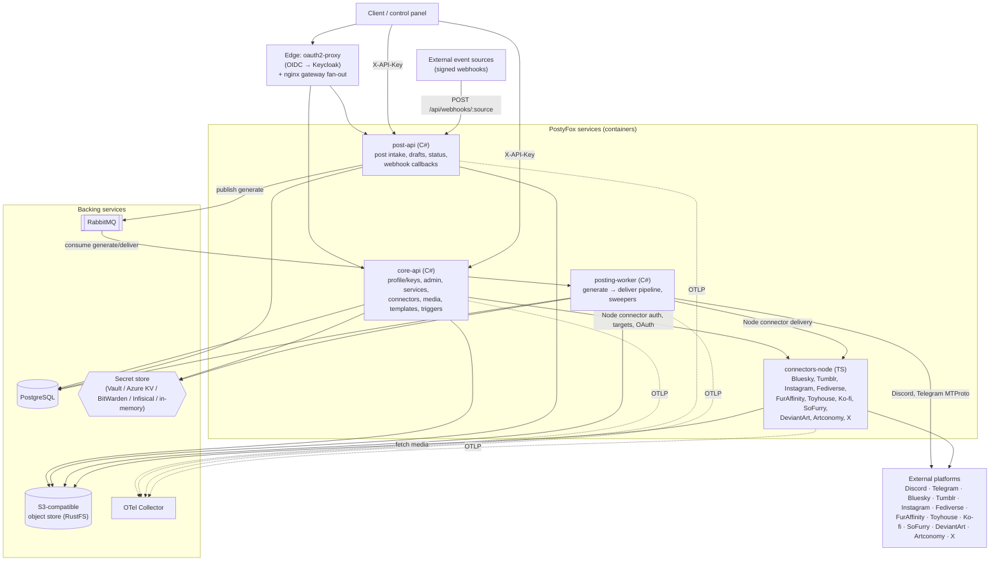
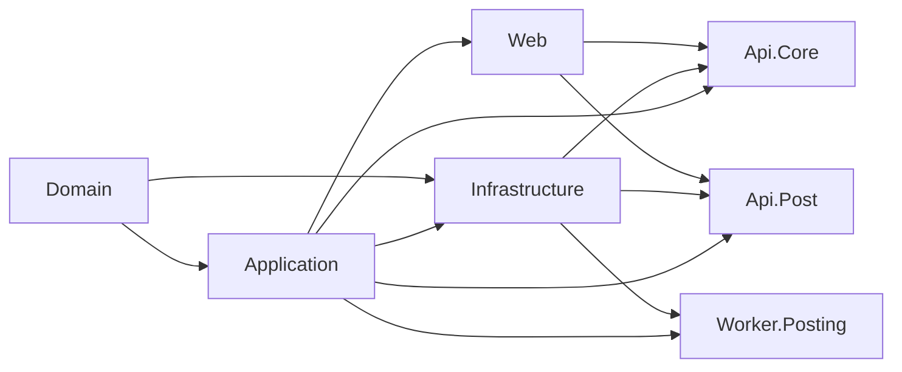
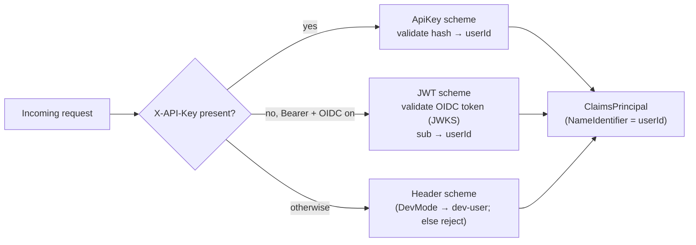
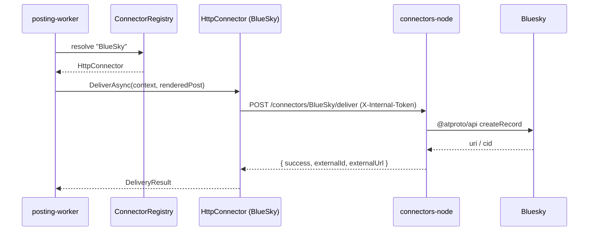
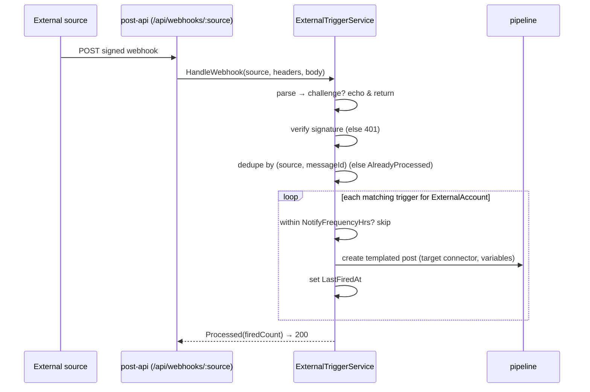

# PostyFox Platform: Architecture (as built)

This describes the **containerised PostyFox platform**.
For the key decisions and their rationale see [`DECISIONS.md`](./DECISIONS.md);
for running, building and configuring it see [`DEVELOPMENT.md`](./DEVELOPMENT.md).

> Diagrams are Mermaid (render on GitHub).

---

## 1. Overview

PostyFox is a multi-platform social **broadcasting / cross-posting backend**. A user connects social
accounts ("connectors"), then either publishes a post that is rendered per-platform and delivered to
every selected target, or registers an **external trigger** that auto-posts when a signed inbound
event arrives. This repo is the backend + infrastructure only (the control-panel UI is separate).

### Design principles

- **Cloud-agnostic**: no hard dependency on any single cloud; every external concern (DB, object
  store, message bus, secrets, auth edge, telemetry) sits behind an abstraction with a swappable
  implementation.
- **Stateless services, async pipeline**: APIs are stateless and horizontally scalable; delivery
  is decoupled through a message bus so it scales on queue depth and survives restarts.
- **Uniform extensibility**: adding a platform means implementing one connector contract; adding an
  event source means implementing one trigger-source contract.
- **Two language stacks by fit**: C# for the bulk; Node/TypeScript where its libraries or web-form
  tooling are materially better (every platform except Discord and Telegram), behind the same
  connector contract.

---

## 2. Container view



### Components

| Component | Runtime | Responsibility |
|-----------|---------|----------------|
| **core-api** | ASP.NET Core (.NET 11) | Identity/API keys, settings, account delegation, terms, admin, service catalogue, connector CRUD + auth/target/OAuth/cookie-pairing ops, media upload + Instagram staging, templates, tag presets, trigger registration. Applies EF migrations + seeds catalogue on boot. |
| **post-api** | ASP.NET Core (.NET 11) | Post intake, drafts, status/history, cancel/delete, automations; inbound external-trigger webhook callbacks. Publishes pipeline commands. |
| **posting-worker** | .NET Worker | Consumes `generate`/`deliver` queues; renders + delivers each target; owns retries/backoff/DLQ + status rollup. Hosts the retention, token-refresh and automation sweepers. |
| **connectors-node** | Node 24 / Fastify | Every platform except Discord and Telegram (see section 6) behind an `IConnector`-shaped HTTP contract; internal-token auth; stateless. |
| PostgreSQL | n/a | System of record. |
| S3-compatible object store (RustFS) | n/a | Media, post payloads, Telegram MTProto sessions, Instagram staging. |
| RabbitMQ | n/a | Pipeline queues (`generate`, `deliver`, `automation`); TTL holding queues for retry backoff. No plugins beyond the bundled Prometheus exporter. |
| Secret store | n/a | Per-user connector secrets, platform secrets, trigger signing secrets. Pluggable provider (HashiCorp Vault, Azure Key Vault, BitWarden/VaultWarden, Infisical, or in-memory) via the `adapters-secrets` library. |
| oauth2-proxy + Keycloak | n/a | OIDC edge, always on (including local compose); forwards the OIDC bearer token, which the APIs validate. Sessions in Redis/Valkey. |
| nginx gateway | n/a | Path-routes the edge to core-api, post-api and the frontend; serves the maintenance page. |
| OTel Collector | n/a | Traces + metrics sink (OTLP). |

---

## 3. Code structure (.NET solution)

Clean-architecture layering; dependencies point inward.



| Project | Contents                                                                                                                                                                                                                           |
|---------|------------------------------------------------------------------------------------------------------------------------------------------------------------------------------------------------------------------------------------|
| `PostyFox.Domain` | Entities + enums. No dependencies.                                                                                                                                                                                                 |
| `PostyFox.Application` | Abstractions (`IAppDbContext`, `IObjectStore`, `IMessageBus`, `IConnector`, `ITelegramGateway`, `ITriggerSource`, …), services/use-cases, template engine, pipeline handlers, connector + trigger contracts, DTOs. Secrets use `ISecretsProvider` from the external `adapters-secrets` library. |
| `PostyFox.Infrastructure` | EF Core `AppDbContext` + migrations, S3 object store, RabbitMQ bus + topology, secret-store provider wiring (`adapters-secrets`), connectors (Discord, Telegram/WTelegram, `HttpConnector`), media processing (ImageSharp, FFMpegCore), SMTP email, catalogue seeder.                                                |
| `PostyFox.Web` | Shared auth handlers (OIDC bearer, API key, test-only header) and OpenTelemetry wiring.                                                                                                                                                                  |
| `PostyFox.Api.Core` / `PostyFox.Api.Post` | Minimal-API hosts + endpoint groups.                                                                                                                                                                                               |
| `PostyFox.Worker.Posting` | Hosts the queue consumers.                                                                                                                                                                                                         |
| `tests/*` | xUnit projects for C#. `connectors-node` has its own tests.                                                                                                                                                                        |

The `Application` layer deliberately depends on EF Core (`IAppDbContext` exposes `DbSet<>`),
trading a little purity for far less repository boilerplate.

---

## 4. Data model

```mermaid
erDiagram
    users ||--o{ api_keys : owns
    users ||--o{ user_connectors : configures
    users ||--o{ templates : owns
    users ||--o{ text_templates : owns
    users ||--o{ tag_presets : owns
    users ||--o{ posts : creates
    users ||--o{ external_triggers : registers
    users ||--o{ account_invites : sends
    users ||--o{ account_members : "grants access as owner"
    users ||--o{ terms_acceptances : accepts
    terms_of_service ||--o{ terms_acceptances : "accepted as"
    service_definitions ||--o{ user_connectors : "instance of"
    user_connectors ||--o{ connector_destinations : exposes
    user_connectors ||--o{ connector_cookie_pairings : "paired by"
    posts ||--o{ post_targets : "fans out to"
    post_targets ||--o{ post_target_automations : schedules
    user_connectors ||--o{ post_targets : "delivered via"

    users {
        string Id PK "OIDC subject"
    }
    api_keys {
        guid Id PK
        string UserId
        string Prefix
        string KeyHash
        datetime RevokedAt
    }
    service_definitions {
        string Id PK
        string Platform
        string ConfigSchema
        string SecureConfigSchema
        bool Enabled
    }
    user_connectors {
        guid Id PK
        string UserId
        string ServiceDefinitionId FK
        string ConfigJson
        bool Enabled
    }
    templates {
        guid Id PK
        string UserId
        string Title
        string MarkdownBody
    }
    posts {
        guid Id PK
        string UserId
        string TagsJson
        string MediaManifestJson
        string VariablesJson
        guid TemplateId
        datetime PostAt
        string RootStatus
    }
    post_targets {
        guid Id PK
        guid PostId FK
        guid ConnectorId
        string Platform
        string RenderedContentJson
        string Status
        string ExternalId
        int Attempts
    }
    post_target_automations {
        guid Id PK
        guid PostTargetId FK
        string Action "Repost | Delete"
        double DelayHours
        datetime DueAt
    }
    connector_destinations {
        guid Id PK
        guid ConnectorId FK
        string ExternalId
        string Name
    }
    connector_cookie_pairings {
        guid Id PK
        guid ConnectorId FK
        string TokenHash
        datetime ExpiresAt
    }
    text_templates {
        guid Id PK
        string UserId
    }
    tag_presets {
        guid Id PK
        string UserId
    }
    external_triggers {
        guid Id PK
        string UserId
        string SourceType
        string ExternalAccount
        guid TemplateId
        guid TargetConnectorId
        int NotifyFrequencyHrs
        datetime LastFiredAt
    }
    external_interests {
        string SourceType PK
        string ExternalAccount PK
        string UserId PK
    }
    webhook_dedupe {
        string Source PK
        string MessageId PK
        datetime SeenAt
    }
    account_invites {
        guid Id PK
        string OwnerUserId
        string OwnerEmail
        string InviteeEmail
        string TokenHash
        string TokenPrefix
        string Status
        datetime ExpiresAt
        string AcceptedByUserId
    }
    account_members {
        string OwnerUserId PK
        string MemberUserId PK
        string OwnerEmail
        string MemberEmail
        guid InviteId
    }
    terms_of_service {
        int Version PK
        string Content
        string PublishedByUserId
        datetime PublishedAt
    }
    terms_acceptances {
        string UserId PK
        int TermsVersion PK
        datetime AcceptedAt
    }
```



Notes:
- **Secrets are never in domain tables.** Per-user connector secrets live in the secret store under
  `conn-{connectorId:N}-{userId}`; trigger signing secrets under `trigger-{sourceType}-signing`;
  platform secrets (e.g. `TelegramApiID`/`TelegramApiHash` and
  `TumblrConsumerKey`/`TumblrConsumerSecret`, `SofurryClientId`/`SofurryClientSecret`, `DeviantartClientId`/`DeviantartClientSecret`) under their own names. The store is a
  pluggable `ISecretsProvider` (`adapters-secrets` library): in-memory for local/dev, and
  HashiCorp Vault, BitWarden/VaultWarden, Azure Key Vault, or Infisical for deployments, selected via
  `Secrets:Provider`. There is no database table backing it. The fixed platform-secret catalogue is
  managed through `/api/admin/operational-secrets`, protected by the `postyfox-admin` Keycloak role;
  API responses expose configured status only, never values.
- **Enums stored as strings** (`RootStatus`, `Status`) for readability.
- **Object store**: `post/{postId}/{title|description|description-html}`, media manifest entries, and
  `telegram/{userId}` MTProto session blobs, and short-lived `instagram-staging` objects.

---

## 5. Authentication & authorisation



- A **policy scheme** (`PostyFox`) forwards by credential: `X-API-Key` → ApiKey; else an
  `Authorization: Bearer` token (when OIDC is enabled) → JWT; otherwise the Header scheme.
- **JWT scheme** validates the OIDC bearer token the oauth2-proxy edge forwards, in-app, against the
  realm's JWKS (issuer + lifetime + optional audience). This is the production path: the APIs trust
  **no** injected identity header.
- **Header scheme** authenticates as `Auth:DevUserId` only when `Auth:DevMode=true` (a test-only
  in-process switch; no shipped configuration enables it). Otherwise it rejects: a raw
  `X-Auth-Request-User` header is never trusted.
- **API-key scheme** validates the presented key against a PBKDF2 hash (constant-time), for
  external/machine callers (the retained requirement). Keys are prefix-indexed; the secret is never
  stored.
- Webhook callbacks are anonymous at the auth layer and instead authenticated per-source by
  **signature verification** (see point 8).
- **Account delegation** (issue #409): after the scheme above resolves a `ClaimsPrincipal`, an
  `IClaimsTransformation` (`ActAsClaimsTransformation`) checks for an `X-Act-As` header naming an
  owner UserId. If an `AccountMember` row grants the caller access to that owner, `NameIdentifier`
  is swapped to the owner's id for the rest of the request: every endpoint reads the current user
  from that one claim, so nothing downstream needs to know delegation exists. A missing/invalid
  membership is ignored (the header is dropped, not rejected), since nothing is granted beyond what
  the membership check itself allows. Access is invited by email (`AccountInvite`, delivered by
  SMTP) and cross-checked against the invitee's own OIDC email at accept time.
- **Terms of service** (issue #417): admins publish terms (Markdown) via `PUT /api/admin/terms`.
  Each publish is a new `terms_of_service` version; blank content turns the terms off. While terms
  are in force, `TermsOfServiceMiddleware` (both APIs, after authorisation) returns 403 with a
  `code` of `terms_not_accepted` for any authenticated request, OIDC or API key, until the signed-in
  person has a `terms_acceptances` row for the current version. When acting as another account, the
  owner must also have accepted (`owner_terms_not_accepted`). Anonymous endpoints (webhooks,
  health, version), `/api/terms`, `/api/admin/access` and `PUT /api/admin/terms` are exempt, so
  an admin can fix or turn off a bad publish without accepting it. Background delivery of
  already-scheduled posts and triggers is not gated.

---

## 6. Connector framework

Every platform implements `IConnector`: `Describe`, `IsAuthenticatedAsync`, `ListTargetsAsync`,
`DeliverAsync`. A `ConnectorRegistry` resolves connectors by platform key. The delivery handler and
the connector-ops endpoints never hard-code a platform.

| Platform | Where it runs | Library / mechanism |
|----------|---------------|---------------------|
| Discord | C# in-process | webhook HTTP |
| Telegram | C# in-process | **MTProto user account** via `WTelegramClient`, behind `ITelegramGateway` |
| Bluesky | connectors-node | `@atproto/api` |
| Tumblr | connectors-node | `tumblr.js` |
| FurAffinity | connectors-node | Cookie-authenticated HTML form workflow |
| Toyhouse | connectors-node | Cookie-authenticated HTML form workflow |
| X | connectors-node | `rettiwt-api` over paired browser cookies (against X's terms of service) |
| Ko-fi | connectors-node | Cookie-authenticated site form workflow |
| SoFurry | connectors-node | Documented public API, OAuth2 + PKCE connect flow |
| DeviantArt | connectors-node | Documented API (Sta.sh submit + publish), OAuth2 + PKCE connect flow |
| Artconomy | connectors-node | Cookie-authenticated calls to the site's own JSON API |
| Instagram | connectors-node | Content Publishing API (Business Login for Instagram), OAuth2 connect flow; fetches media by URL from core-api's staged-media route |
| Fediverse (Mastodon, Pleroma, Akkoma, Friendica, Iceshrimp, GoToSocial, Hometown, Pixelfed) | connectors-node | `megalodon`, one generic connector; SNS auto-detected per instance; OAuth2 / MiAuth connect flow |

Optional capabilities sit beside `IConnector` and are discovered by type: `IOAuthConnector`,
`ILimitsConnector`, `IRefreshableConnector` (expiring tokens, renewed by `ConnectorTokenRefreshSweeper`
and before use), and `IRepostConnector` / `IDeleteConnector` (used by post automations).

**Cookie pairing (ADR-010).** Scraper-backed login is a one-click hand-off from the PostyFox Connect browser extension. Because the
extension carries the user's own PostyFox session, it takes two calls and no user input:
`GET /api/connectors/cookie-pairing/targets` (which connector, which cookies, which login page) then
`POST /api/connectors/cookie-pairing/pair`. Only the cookie names the platform's `CookiePairingSpec`
declares are read or stored, and the connector is created on the spot if the user has none. The
five-minute one-use pairing token (`/cookie-pairing/start` → `/cookie-pairing/complete`, with public
site metadata at `/cookie-pairing/sites`) remains as a fallback for a browser that cannot present a
PostyFox session. See [`clients/postyfox-connect`](../clients/postyfox-connect/README.md).

**Per-submission platform options.** Some platforms take choices that describe the *submission* rather
than the account: FurAffinity's category, theme, species, gender and gallery folders; Toyhouse's
character IDs, artist credit and privacy/watermark choices; every Fediverse platform's content
warning. A connector declares these as field descriptors on
`ConnectorDescriptor.PostOptionsSchema` (surfaced as `postOptionsSchema` on `GET /api/services`); the
compose form renders them once per selected target and sends them as `targetOptions` on
`POST /api/posts`, keyed by connector id. They are validated against the same schema at intake, stored
on the `PostTarget`, and applied over the connector's config when delivery builds its
`ConnectorContext`, so connectors keep reading a single config object. Options lists too large for a
C# literal live in [`Persistence/Schemas`](../src/PostyFox.Infrastructure/Persistence/Schemas/README.md).

**Content warnings (Fediverse).** Mastodon, Pleroma, Akkoma, Friendica, Iceshrimp, GoToSocial,
Hometown and Pixelfed all support a click-to-reveal content warning (Mastodon's API calls this
`spoiler_text`; megalodon maps it to Misskey's `cw` for the firefish driver Iceshrimp uses), declared via
`ConnectorDescriptor.SupportsContentWarning` and surfaced as the "Content warning" capability badge on
`GET /api/services`. It is an explicit, optional per-submission field (`ContentWarning` in
`PostOptionsSchema`), **never** derived from the post title, which is an unrelated field most of these
platforms don't even render. No other connector (Bluesky, Tumblr, FurAffinity, Toyhouse, Instagram,
Discord, Telegram) has an equivalent mechanism.

**Per-instance limits.** Fediverse instances each configure their own caps, so the static per-platform `MaxContentLength` is only a fallback hint. `GET /api/connectors/{id}/limits` reports the connector's real limits (`{ maxContentLength, maxMediaAttachments, supportedMimeTypes, imageSizeLimit, videoSizeLimit }`, sizes in bytes), fetched live from the instance (`getInstance()`) for Fediverse connectors via the optional `ILimitsConnector` capability, falling back to the descriptor value for others. Delivery **enforces** these limits and fails clearly (no silent truncation) if a post exceeds the instance's character count, attachment count, an unsupported media MIME type, or a media file-size cap.

The C# **`HttpConnector`** adapter fulfils `IConnector` for Node-hosted platforms by forwarding to
connectors-node over HTTP (`POST /connectors/{platform}/{is-authenticated|list-targets|limits|deliver|repost|delete|refresh-token}`
and the OAuth `request-token`/`access-token` pair),
passing the resolved config + secret in the request body. All internal calls carry a shared
`X-Internal-Token`. **Media is passed by reference** (`{container, key, contentType, alt}`). The
Node service fetches the bytes from the shared object store itself (its own S3 client), so no media
bytes cross the internal hop. The Node service holds no session state.

**Media normalisation is a core, shared step every connector runs before upload.** Because one
uploaded asset fans out to many targets with different caps, and the object store keeps the canonical
original, normalisation happens **per-target at delivery time** against each platform's `MediaSpec`
(max dimensions / bytes / duration, accepted formats, attachment count). Still images are downscaled
and re-encoded; video and animated GIFs are transcoded; formats the target doesn't accept are
converted; media that can't be brought within limits fails only its own target. There is exactly one
building block per stack, reused by every connector: in C#, `IMediaResolver` (fetch + cap + normalise)
over `IMediaProcessor` (ImageSharp for stills, FFMpegCore for video); in connectors-node, `src/media/`
(`sharp` for stills, `fluent-ffmpeg` for video). Connectors that report live limits (Fediverse) merge
the instance's reported caps over the static spec. The `ffmpeg` binary is installed in the
posting-worker and connectors-node runtime images.

**Video (issue #40).** Platforms that take video receive it in their own native form (Bluesky video
embed via its video service, Tumblr NPF video block, Telegram document with a video attribute so it
plays inline). An image-only platform that accepts GIF can take a video as a silent GIF when the author
picks the `VideoAsGif` post option for that target; without it, the compose form blocks the post.
`supportedMimeTypes` in a connector's limits includes its video formats, which is how the client tells
the two kinds of platform apart.

**Aspect-ratio framing (issue #39).** A spec can declare a width ÷ height range the platform rejects
images outside of (Instagram: 4:5 to 1.91:1), reported to the frontend through the connector's
limits and the media-check endpoint (`NeedsFraming`). The author chooses, per image, to pad (a colour,
or transparent where the output format keeps alpha, else white) or crop to a region; the choice
travels on the `MediaRef` as `Framing` and is applied only on platforms whose range the image falls
outside, so every other target still gets the full image. With no choice, delivery to such a platform
fails with a clear error rather than being cropped silently. Platforms that crop previews themselves
get display hints instead: Bluesky receives each image's `aspectRatio`, and Fediverse instances
receive the crop centre as the media focal point.



**Telegram statefulness**: MTProto login is interactive and session-based. Sessions persist to the
object store; in-progress login clients are held per-instance. Route a user's Telegram operations to
a single instance (consistent hashing / dedicated telegram-worker) so concurrent replicas don't
corrupt an in-progress session. The MTProto work sits behind `ITelegramGateway` so the connector and
login flow are unit-tested with a fake.

---

## 7. Posting pipeline

```mermaid
sequenceDiagram
    actor U as User
    participant P as post-api
    participant Q as RabbitMQ
    participant W as posting-worker
    participant C as Connector
    U->>P: POST /api/posts (targets, content, PostAt?)
    P->>P: persist Post + PostTarget[] (Queued), store payload
    P->>Q: publish generate(target) [immediate posts; scheduled ones wait for PostSchedulerSweeper]
    P-->>U: 202 { postId }
    Q->>W: generate(target)
    W->>W: render via template engine → Ready
    W->>Q: publish deliver(target)
    Q->>W: deliver(target)
    W->>C: DeliverAsync
    alt success
        C-->>W: externalId/url → Delivered
    else transient failure (attempts < max)
        W->>Q: re-publish deliver(target) with exponential backoff
    else exhausted
        W->>W: Failed
    end
    W->>W: recompute root status
    U->>P: GET /api/posts/{id} → aggregated status
```

Target states: `Queued → Generating → Ready → Delivering → Delivered | Failed`, plus `Cancelled`
(user stopped it before it was sent). Root rollup: all delivered → `Delivered`; mixed terminal →
`PartiallyFailed`; none delivered → `Failed`; all cancelled → `Cancelled`; otherwise
`Delivering`/`Generating`/`Queued`. A root can also be `Draft`: saved but not submitted, with no
queue activity until `POST /api/posts/{id}/publish`. `PUT /api/posts/{id}` edits a draft and returns
409 once it is published. Retry count and base backoff are configured via
`Pipeline:MaxDeliveryAttempts` / `Pipeline:RetryBaseSeconds`.

**Cancel & delete.** `POST /api/posts/{id}/cancel` moves every not-yet-sent target
(`Queued`/`Generating`/`Ready`) to `Cancelled`; already-delivered or in-flight (`Delivering`) targets
are left as-is, so a partially-sent post keeps what went out. Cancellation is status-based, not a
queue purge: a queued or retrying generate/deliver message for a cancelled target no-ops when it fires (the
handlers skip `Cancelled`). `DELETE /api/posts/{id}` hard-deletes a single post (row + cascade
targets + stored payload/media via the shared `PostPayloadCleaner`): for history entries and for
stale/orphaned queued rows; removing the row means any pending queue message for it finds no target
and no-ops. `POST /api/posts/{id}/duplicate` returns the authored content so the compose form can
recreate a past post ("post again"): its media is copied to fresh, user-owned blobs (via
`MediaCopier`) so the recreated post is fully self-contained and deleting/expiring the original never
pulls a blob out from under the copy.

**History & activity.** `GET /api/posts` lists a user's posts newest-first (id, title, aggregated
status, per-target counts + platforms), always bounded by the retention window; `?filter=active`
narrows to the in-flight posts (`Queued`/`Generating`/`Delivering`) so a client can show "what's
processing now" even after the user navigates away from the compose screen. Posts are retained for a
configurable window (`Retention:PostRetentionDays`, default 30 days); a background
`PostRetentionSweeper` hosted in the posting-worker hard-deletes older posts (targets cascade) along
with their stored payloads and referenced media (`Retention:Enabled`, `SweepIntervalHours`,
`SweepBatchSize`). `DELETE /api/posts/history` clears every terminal post at once.

**Automations (issue #323).** A target can carry repost or delete rules (`post_target_automations`)
that fire a set number of hours after the target delivers. `DeliverTargetHandler` stamps `DueAt` on
delivery and the worker's `PostAutomationSweeper` enqueues them when due, against connectors that
implement `IRepostConnector` / `IDeleteConnector`. `DELETE /api/posts/{postId}/automations/{id}`
cancels a pending rule.

---

## 8. External-trigger framework

Source-agnostic. An `ITriggerSource` encapsulates a source's signature scheme and payload shape; a
generic HMAC-signed webhook source ships built-in (`X-Signature` = hex HMAC-SHA256 of the body,
`X-Message-Id` for dedupe).



Registration (`POST /api/triggers`) records an `external_triggers` row (source, external account,
template, target connector, frequency). Fan-out reuses the normal posting pipeline, so triggered
posts get the same rendering, delivery, retry and status behaviour.

---

## 9. Messaging topology

- One durable `direct` exchange (`postyfox`) plus `postyfox.dlx`. No delayed-message plugin: it is
  unmaintained and incompatible with RabbitMQ 4.3+.
- Queues `generate`, `deliver` and `automation`, each bound by routing key = queue name, each
  dead-lettering to `postyfox.dlx` → `{queue}.dlq`.
- Each queue has a `{queue}.retry` holding queue that is never consumed. A delayed re-publish lands
  there with a per-message TTL (AMQP `expiration`) and dead-letters back into the main queue when it
  expires. Only the short, bounded delivery retry backoff uses it, so head-of-line blocking is not a
  concern.
- Scheduling never uses bus delay. `PostSchedulerService` (run by `PostSchedulerSweeper`) claims
  targets whose `PostAt` is due, in batches of `Pipeline:SchedulerBatchSize`, every
  `Pipeline:SchedulerPollSeconds`. `PostAutomationSweeper` does the same for automations.
- Publisher declares the queue before publishing so messages aren't lost if the worker is down.
- Consumers ack on success; an unhandled exception nacks → DLQ (per-target delivery retries are
  handled in the pipeline handler via delayed re-publish, not transport requeue).

---

## 10. Observability, deployment, testing

- **Observability**: OpenTelemetry traces + metrics exported via OTLP (`OTEL_EXPORTER_OTLP_ENDPOINT`)
  to any collector/backend. `/healthz` (liveness) and `/readyz` (DB connectivity) on both APIs.
- **Security hardening**: a global fixed-window **rate limiter** (config-driven, partitioned by
  user/IP, HTTP 429) and conservative **security response headers** on both APIs.
- **Deployment**: three modes, all consuming the same published images
  (`{registry}/{repository}-{service}:{tag}`):
  1. **docker-compose** (`deploy/docker-compose.yml`): full local stack, including Keycloak,
     oauth2-proxy and the gateway. The dev server stack layers `docker-compose.server.yml` +
     `docker-compose.dev.yml` on top.
  2. **Helm chart** (`deploy/helm/postyfox`): the 4 services, gateway, oauth2-proxy and
     config/secret/ingress for any Kubernetes; Postgres, RabbitMQ, Redis, Vault and the OTel collector
     are optional bundles. Production runs this.
  3. **Terraform → Azure Container Apps** (`deploy/terraform-aca`): deploys the published
     images to ACA (external ingress for the APIs, internal for connectors-node, no ingress for the
     worker).

  One templated `Dockerfile` builds each .NET service (build args select project + assembly);
  connectors-node has its own multi-stage Dockerfile. PR Validation (`.github/workflows/pr.yml`)
  builds + tests both stacks and lints the IaC; Build (`.github/workflows/build.yml`) reruns it on
  `main` and builds/pushes images; Deploy, Release and Publish Release are described in
  [`../deploy/README.md`](../deploy/README.md#deployment-flow). The .NET build needs the
  ImageSharp licence, supplied from the `SIXLABORS_LICENSE_KEY` secret (env var for `dotnet build`,
  build secret for images); see [`DEVELOPMENT.md`](./DEVELOPMENT.md#imagesharp-licence).
- **Config**: 12-factor env vars, nested with `__` (see [`DEVELOPMENT.md`](./DEVELOPMENT.md#configuration)).
- **Testing**: unit + integration tests per layer using in-memory SQLite / EF-InMemory and fakes for
  I/O. No Docker required. The pipeline is covered end-to-end via an in-process bus that drives the
  real handlers. Not covered: the live MTProto gateway and the live external-platform calls (need
  real credentials). The logic around them is tested via seams.

---

## 11. Known constraints & follow-ups

See [FOLLOWUPS.md](./FOLLOWUPS.md) for the full list. Headlines:

- Media delivery is fully implemented, including per-platform resize/transcode normalisation for images
  and video. Remaining omissions are around documents (pass-through), a normalized-variant cache, and
  pre-signed uploads. See [FOLLOWUPS.md](./FOLLOWUPS.md).
- Telegram MTProto is stateful (single-writer routing) and not integration-tested (needs live creds).
- Trigger signing secrets have no admin endpoint (connector operational secrets do, at
  `/api/admin/operational-secrets`).
- Twitch was descoped and is intentionally absent. Twitch support is expected to come from the
  companion Twitch Tools project, integrating through the external-trigger framework.
